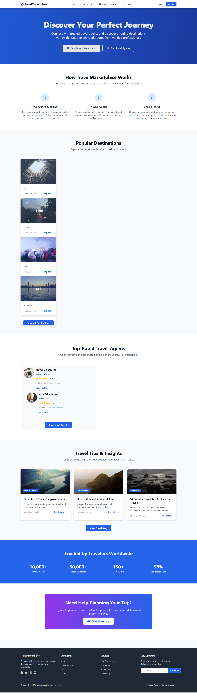
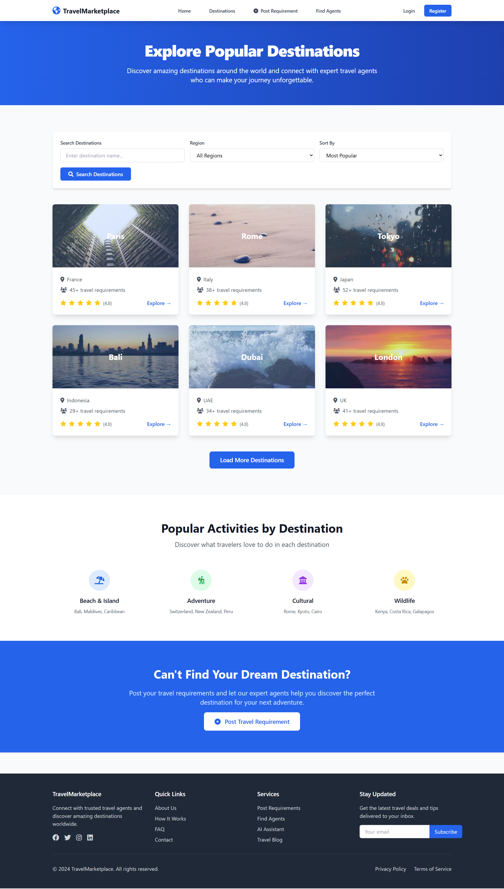

# Travel Marketplace

This is a comprehensive multi-vendor travel marketplace application built with Django, enabling customers to submit travel requirements, agents to provide quotes, and bookings to be made seamlessly through the platform. The platform generates commission from both agents (2%) and customers (1%) on successful transactions.

## Screenshot

## Features

The Travel Marketplace is equipped with a robust set of features designed to facilitate a seamless experience for customers, agents, and administrators:

### Key Functional Areas:
- **User Management**:
    - Secure user registration, authentication, and profile management.
    - Role-based access control ensuring distinct functionalities for customers, agents, and admins.
    - Agent verification and approval workflows for quality assurance.
- **Requirements & Quotes Workflow**:
    - **Dynamic Requirement Submission**: Customers can submit detailed travel requirements using dynamic forms that adapt to different service types (e.g., flights, hotels), including support for attachments.
    - **Agent Quote Management**: Agents can browse open requirements, create, submit, and manage quotes through an intuitive builder with rich text editing and template capabilities.
    - **Quote Comparison**: Customers can compare multiple quotes side-by-side to make informed decisions.
- **Booking & Payments**:
    - **Seamless Booking Process**: Facilitates booking finalization directly through the platform.
    - **Payment Integration (PayPal)**: Secure processing of payments for bookings.
    - **Commission System**: Automated calculation and management of commissions from agents (2%) and customers (1%) on successful bookings.
    - **Transaction Tracking**: Detailed recording and status updates for all financial transactions.
- **Dashboards & Reporting**:
    - **Customer Dashboard**: Provides personalized views for tracking submitted requirements, managing bookings, comparing quotes, and reviewing notifications.
    - **Agent Dashboard**: Offers insights into earnings, performance metrics, and tools for managing requirements, quotes, and bookings.
    - **Admin Panel**: Centralized control for system overview, user and agent management, comprehensive analytics, dispute resolution, and system configuration (e.g., commission rates).
- **Travel Search & Discovery (Amadeus API Integration)**:
    - **Advanced Flight & Hotel Search**: Leverage Amadeus API for real-time and comprehensive flight and hotel availability and pricing.
    - **Flight Inspiration**: Enables users to discover potential destinations based on specified origin and budget.
    - **Airport Autocomplete**: Streamlined search experience for origin/destination inputs.
    - **Search History & Caching**: Stores recent searches and caches API responses to improve performance and reduce redundant API calls.
- **Notifications & Communication**:
    - Real-time notification system to keep users informed about requirement updates, new quotes, payment statuses, and system alerts.
    - Configurable email services for various communications.

### Technical Foundation & Infrastructure:
- **Django Framework**: Built on Python's Django, ensuring a scalable, secure, and maintainable backend.
- **Django REST Framework**: Provides a powerful, flexible toolkit for building robust Web APIs.
- **Database**: Utilizes PostgreSQL for reliable and structured data storage.
- **Caching (Redis)**: Implements Redis for session management, caching, and background task queues (Celery).
- **Asynchronous Task Processing (Celery)**: Handles long-running tasks like API calls and email sending in the background.
- **Static & Media File Management**: Optimized handling and serving of static assets and user-uploaded media.
- **API Key Management**: Centralized and secure management of third-party API credentials.
- **Logging & Monitoring**: Comprehensive logging (e.g., `/debug.log`) for system activities and errors, supporting integration with external monitoring tools.
- **CORS Support**: Configured for secure cross-origin resource sharing, essential for frontend interactions.

## Deployment

This section provides a high-level overview of the deployment process. For detailed instructions, please refer to the `DEPLOYMENT.md` file in the `deploy/` directory.

### Prerequisites

- **Operating System**: Ubuntu 20.04+ or CentOS 8+
- **Python**: 3.9+
- **Node.js**: 16+ (for frontend build tools)
- **PostgreSQL**: 12+
- **Redis**: 6+
- **Nginx**: 1.18+
- **SSL Certificate**: For production HTTPS

### Environment Setup

1.  **Project Directory**: Create `/opt/travel_marketplace`.
2.  **Clone Repository**: `git clone https://github.com/your-org/travel-marketplace.git .`
3.  **Python Environment**: `python3.9 -m venv venv`, `source venv/bin/activate`, `pip install -r requirements.txt`.
4.  **Environment Variables**: Copy `deploy/.env.example` to `.env` and configure `SECRET_KEY`, `DATABASE_URL`, `REDIS_URL`, `ALLOWED_HOSTS`.

### Database Configuration

- **PostgreSQL**: Set up user and database (e.g., `travel_marketplace`).
- **Migrations**: `python manage.py migrate`.

### Application Configuration

- **Static Files**: `python manage.py collectstatic --noinput`, configure permissions.
- **Celery**: Set up Celery user and directories.
- **SSL Certificate**: Configure Nginx for SSL (Certbot recommended).

### Deployment Methods

#### 1. Docker Deployment (Recommended)

- Build Docker Image: `docker build -t travel-marketplace:latest .`
- Deploy with Docker Compose: `docker-compose -f deploy/docker-compose.yml up -d`
- Services include: `web` (Django/Gunicorn), `db` (PostgreSQL), `redis`, `celery`, `celery-beat`, `nginx`.

#### 2. Manual Deployment

- **Systemd Services**: Create and configure `systemd` services for Gunicorn (`travel-marketplace.service`) and Celery (`celery.service`).
- **Nginx Configuration**: Copy and enable `deploy/nginx/nginx.conf`, test, and reload Nginx.
- **Start Services**: `sudo systemctl daemon-reload`, `sudo systemctl enable/start travel-marketplace celery nginx`.

### Testing

The project includes automated tests (unit, integration, load, security) that can be run using `python manage.py test`. Refer to `DEPLOYMENT.md` for specific commands and security tools.

### Monitoring

- **Application Monitoring**: Health checks (`/health/`), detailed logging (e.g., `/var/log/django/travel_marketplace.log`).
- **Performance Monitoring**: APM integration (Sentry, New Relic, Datadog), database slow query logging.
- **Infrastructure Monitoring**: Prometheus and Grafana for system-level metrics.

### Security

- **Firewall**: Configure UFW to allow necessary ports (SSH, HTTP, HTTPS).
- **Security Headers**: Application includes HSTS, X-Frame-Options, X-Content-Type-Options, CSP.
- **SSL Configuration**: Regular SSL certificate testing and renewal.
- **Regular Updates**: Automated system and Python package updates, security scans with Bandit and Safety.

---

**Note**: This `README.md` provides an overview. For detailed step-by-step instructions on deployment and other configurations, please consult `DEPLOYMENT.md`, `implementation_plan.md`, and other relevant documentation files.
