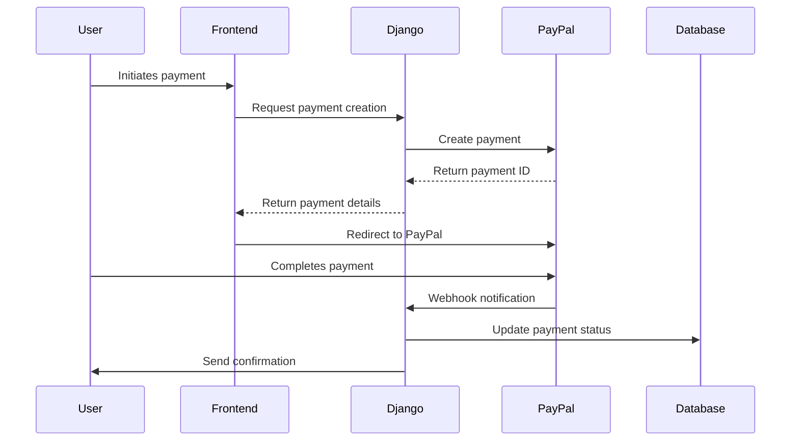
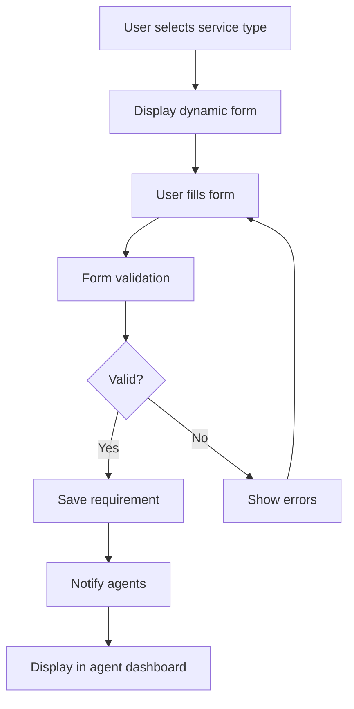
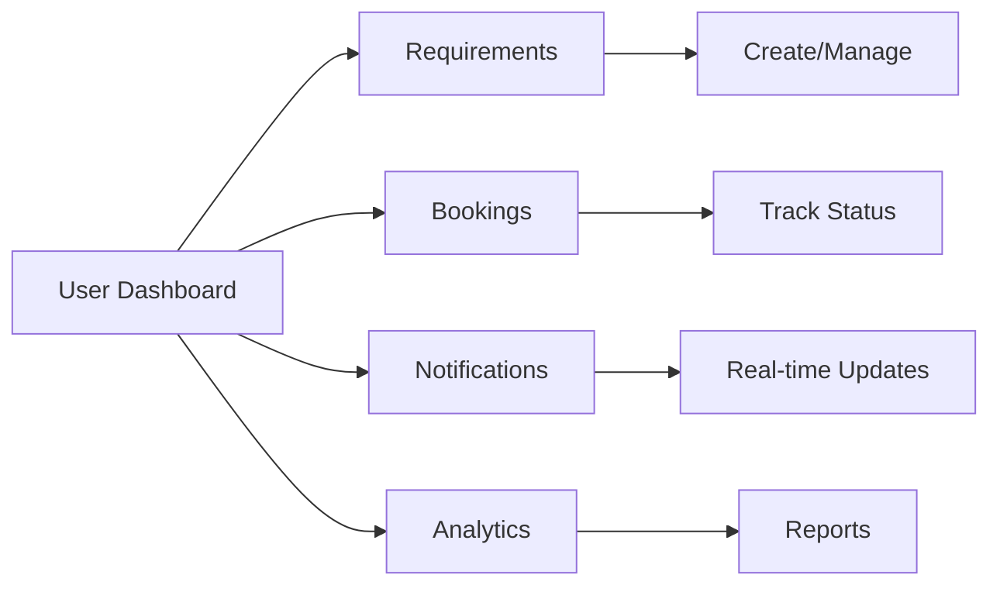

# Django Travel Marketplace - Implementation Plan for Missing Features

## Executive Summary

This document outlines a detailed implementation plan for the missing features in the Django travel marketplace project. The project is a multi-vendor travel marketplace where customers can submit travel requirements, agents can provide quotes, and bookings can be made through the platform. The platform earns commission from both agents (2%) and customers (1%).

## Current State Analysis

### What's Already Implemented
- Well-structured Django project with multiple apps
- Comprehensive models for all entities (User, Agent, Requirements, Quotes, Bookings, Payments)
- Basic URL configurations
- Commission calculation logic in Booking model
- User dashboard views with real data
- Agent dashboard views (with mock data that needs replacement)
- Partial payment template

### Key Implementation Gaps
1. **Payment Integration (PayPal)** - Critical for MVP
2. **User Requirement Submission flow** - Incomplete form handling
3. **User Dashboard functionality** - Partially implemented
4. **Agent Dashboard functionality** - Contains mock data
5. **Admin Panel views and UI implementation** - Almost empty

## Priority-Based Implementation Plan

### 1. Payment Integration (PayPal) - Critical for MVP
**Priority**: 1 (Highest)
**Estimated Effort**: High (3-4 weeks)

#### Technical Specifications
- Integrate PayPal SDK for payment processing
- Implement secure payment flow with proper error handling
- Support for both sandbox and live environments
- Webhook handling for payment confirmations
- Transaction recording and status updates

#### Implementation Steps
1. **PayPal Service Layer** (Week 1)
   - Create `payments/services/paypal_service.py` with core PayPal API functions
   - Implement payment creation, capture, and refund methods
   - Add webhook verification and processing
   - Create utility functions for error handling

2. **Payment Views** (Week 1-2)
   - Complete `bookings/views.py/payment()` with PayPal integration
   - Implement `paypal_success()` and `paypal_cancel()` views
   - Add webhook handler view `paypal_webhook()`
   - Create payment status checking endpoint

3. **Transaction Management** (Week 2)
   - Update `paymentsdetails/models.py` Transaction model with PayPal fields
   - Implement transaction recording in payment flow
   - Create payment status update mechanisms
   - Add refund processing logic

4. **Frontend Integration** (Week 2-3)
   - Update `templates/bookings/payment.html` with PayPal buttons
   - Add JavaScript SDK integration
   - Implement payment status indicators
   - Create payment confirmation/failure pages

5. **Testing & Error Handling** (Week 3-4)
   - Implement comprehensive error handling
   - Add payment timeout handling
   - Create test cases for all payment scenarios
   - Add logging for payment events

#### Required Models
- Already exists in `paymentsdetails/models.py` (Transaction, PaymentMethod)
- Need to add PayPal-specific fields if missing

#### Required Views
- Complete `bookings/views.py/payment()`
- Add `bookings/views.py/paypal_success()`
- Add `bookings/views.py/paypal_cancel()`
- Add `bookings/views.py/paypal_webhook()`

#### Required Templates
- Update `templates/bookings/payment.html`
- Create `templates/bookings/payment_success.html`
- Create `templates/bookings/payment_failed.html`

#### Integration Points
- Connect with Booking model for payment status updates
- Update agent earnings on successful payment
- Trigger notifications for payment events
- Record transactions in PaymentDetails app

#### Potential Challenges
- PayPal API integration complexity
- Handling payment failures and retries
- Security for webhook verification
- Managing payment timeouts

### 2. Complete User Requirement Submission flow
**Priority**: 2 (High)
**Estimated Effort**: Medium (2-3 weeks)

#### Technical Specifications
- Dynamic form based on service type
- File upload support for attachments
- Form validation and error handling
- Auto-save functionality for drafts
- Requirement status management

#### Implementation Steps
1. **Form Enhancement** (Week 1)
   - Complete `requirements/views.py/create()` with form processing
   - Create dynamic form fields based on service type
   - Implement file upload handling
   - Add form validation and error messages

2. **Form Templates** (Week 1-2)
   - Update `templates/requirements/create.html` with dynamic sections
   - Add JavaScript for conditional field display
   - Implement file upload interface
   - Create form preview functionality

3. **Requirement Management** (Week 2)
   - Complete `requirements/views.py/detail()` implementation
   - Add requirement editing capability
   - Implement requirement status management
   - Create requirement deletion/archival

4. **Integration Features** (Week 2-3)
   - Add notification triggers for new requirements
   - Implement requirement matching with agents
   - Create requirement sharing functionality
   - Add requirement analytics

#### Required Models
- Already exists in `requirements/models.py` (TravelRequirement, ServiceType)

#### Required Views
- Complete `requirements/views.py/create()`
- Complete `requirements/views.py/detail()`
- Add `requirements/views.py/edit()`
- Add `requirements/views.py/delete()`

#### Required Templates
- Update `templates/requirements/create.html`
- Create `templates/requirements/detail.html`
- Create `templates/requirements/edit.html`
- Create `templates/requirements/my_requirements.html`

#### Integration Points
- Connect with User model for requirement ownership
- Trigger notifications to agents
- Link with Quote model for requirement-quote relationships
- Connect with Dashboard for requirement display

#### Potential Challenges
- Dynamic form complexity
- File upload handling
- Form validation for different service types
- Requirement-agent matching logic

### 3. Complete User Dashboard functionality
**Priority**: 3 (High)
**Estimated Effort**: Medium (2-3 weeks)

#### Technical Specifications
- Real-time statistics and analytics
- Requirements management interface
- Booking tracking and management
- Quote comparison functionality
- Notification system

#### Implementation Steps
1. **Dashboard Statistics** (Week 1)
   - Enhance `dashboard/views.py/dashboard()` with real-time stats
   - Implement caching for performance
   - Add trend analysis and charts
   - Create export functionality

2. **Requirements Management** (Week 1-2)
   - Complete `dashboard/views.py/requirements_list()` implementation
   - Add advanced filtering and search
   - Implement bulk actions
   - Create requirement status tracking

3. **Booking Management** (Week 2)
   - Complete `dashboard/views.py/bookings_list()` implementation
   - Add booking status tracking
   - Implement booking actions (cancel, modify)
   - Create booking history view

4. **Quote Comparison** (Week 2-3)
   - Complete `dashboard/views.py/quote_comparison()` implementation
   - Add side-by-side quote comparison
   - Implement quote acceptance/rejection
   - Create quote negotiation features

5. **Notifications** (Week 3)
   - Complete `dashboard/views.py/notifications()` implementation
   - Add real-time notification updates
   - Implement notification preferences
   - Create notification history

#### Required Models
- Already exists in `dashboard/models.py` and related models

#### Required Views
- Already exists in `dashboard/views.py` but needs completion

#### Required Templates
- Already exists in `templates/dashboard/` but needs enhancement

#### Integration Points
- Connect with all user-related models
- Integrate with notification system
- Link with booking and quote systems
- Connect with analytics

#### Potential Challenges
- Real-time data updates
- Complex filtering and search
- Performance optimization
- Quote comparison logic

### 4. Complete Agent Dashboard functionality
**Priority**: 4 (Medium)
**Estimated Effort**: High (3-4 weeks)

#### Technical Specifications
- Replace mock data with real implementation
- Earnings tracking and payout management
- Quote creation and management
- Booking management for agents
- Performance analytics

#### Implementation Steps
1. **Dashboard Statistics** (Week 1)
   - Replace mock data in `agents/views.py/dashboard()` with real data
   - Implement earnings calculation
   - Add performance metrics
   - Create analytics charts

2. **Requirements Browsing** (Week 1-2)
   - Complete `agents/views.py/requirements()` implementation
   - Add requirement filtering and search
   - Implement requirement matching algorithm
   - Create requirement response system

3. **Quote Management** (Week 2-3)
   - Complete `agents/views.py/quotes()` implementation
   - Implement quote builder with rich text editor
   - Add quote template system
   - Create quote analytics

4. **Booking Management** (Week 3)
   - Complete `agents/views.py/bookings()` implementation
   - Add booking status tracking
   - Implement booking actions
   - Create booking calendar view

5. **Earnings and Payouts** (Week 3-4)
   - Complete `agents/views.py/earnings()` implementation
   - Add payout request functionality
   - Implement earnings analytics
   - Create payout history tracking

#### Required Models
- Already exists in `agents/models.py`

#### Required Views
- Already exists in `agents/views.py` but needs completion

#### Required Templates
- Create `templates/agents/dashboard.html`
- Create `templates/agents/requirements.html`
- Create `templates/agents/quotes.html`
- Create `templates/agents/bookings.html`
- Create `templates/agents/earnings.html`

#### Integration Points
- Connect with Agent model for data
- Link with Quote and Booking models
- Integrate with PaymentDetails for earnings
- Connect with Notification system

#### Potential Challenges
- Complex earnings calculations
- Quote builder implementation
- Performance optimization
- Payout request processing

### 5. Admin Panel views and UI implementation
**Priority**: 5 (Medium)
**Estimated Effort**: High (4-5 weeks)

#### Technical Specifications
- Comprehensive admin dashboard
- User and agent management
- System analytics and reporting
- Settings management
- Dispute resolution system

#### Implementation Steps
1. **Admin Dashboard** (Week 1-2)
   - Implement `admin_panel/views.py/dashboard()` with real analytics
   - Create system overview with key metrics
   - Add real-time statistics
   - Implement admin activity tracking

2. **User Management** (Week 2)
   - Create user management views
   - Implement user verification system
   - Add user activity tracking
   - Create bulk user operations

3. **Agent Management** (Week 2-3)
   - Create agent management views
   - Implement agent verification workflow
   - Add agent performance tracking
   - Create agent approval system

4. **Booking and Payment Management** (Week 3-4)
   - Create booking management views
   - Implement payment tracking
   - Add dispute resolution system
   - Create refund management

5. **System Settings** (Week 4-5)
   - Create settings management views
   - Implement commission management
   - Add system configuration
   - Create maintenance mode controls

#### Required Models
- Already exists in `admin_panel/models.py`

#### Required Views
- Complete `admin_panel/views.py/` with all necessary views
- Create admin dashboard, user management, agent management, etc.

#### Required Templates
- Create complete `templates/admin_panel/` directory structure
- Create all necessary admin templates

#### Integration Points
- Connect with all models for comprehensive management
- Integrate with authentication system
- Link with notification system
- Connect with analytics

#### Potential Challenges
- Complex admin permissions
- Large data set handling
- Security considerations
- Performance optimization

## Implementation Timeline

### Phase 1 (Weeks 1-4): Critical MVP Features
- Payment Integration (PayPal)
- Basic User Requirement Submission
- Essential Dashboard functionality

### Phase 2 (Weeks 5-8): Core Features
- Complete User Dashboard
- Agent Dashboard implementation
- Basic Admin Panel

### Phase 3 (Weeks 9-12): Advanced Features
- Complete Admin Panel
- Advanced analytics
- Performance optimization

## Technical Architecture

### Payment Flow

### Requirement Submission Flow

### Dashboard Architecture

## Security Considerations

### Payment Security
- HTTPS enforcement for all payment pages
- CSRF protection for payment forms
- Webhook signature verification
- Sensitive data encryption

### User Data Protection
- Input validation and sanitization
- SQL injection prevention
- XSS protection
- Secure file upload handling

### Access Control
- Role-based permissions
- API rate limiting
- Authentication middleware
- Session management

## Testing Strategy

### Unit Testing
- Model validation tests
- View logic tests
- Service layer tests
- Utility function tests

### Integration Testing
- Payment flow testing
- User journey testing
- API endpoint testing
- Database integration tests

### End-to-End Testing
- Complete user flows
- Payment transactions
- Admin operations
- Cross-browser compatibility

## Deployment Considerations

### Environment Setup
- Environment variable configuration
- Database migration scripts
- Static file handling
- SSL certificate setup

### Monitoring
- Application performance monitoring
- Error tracking
- Payment transaction monitoring
- User activity analytics

## Conclusion

This implementation plan provides a structured approach to completing the missing features in the Django travel marketplace. The priority order ensures that critical MVP features are implemented first, with more advanced features following in subsequent phases.

The plan leverages the existing well-structured codebase while addressing the identified gaps. Each feature includes detailed technical specifications, implementation steps, and integration points to ensure successful implementation.

Regular code reviews, testing, and documentation should be maintained throughout the implementation process to ensure code quality and maintainability.